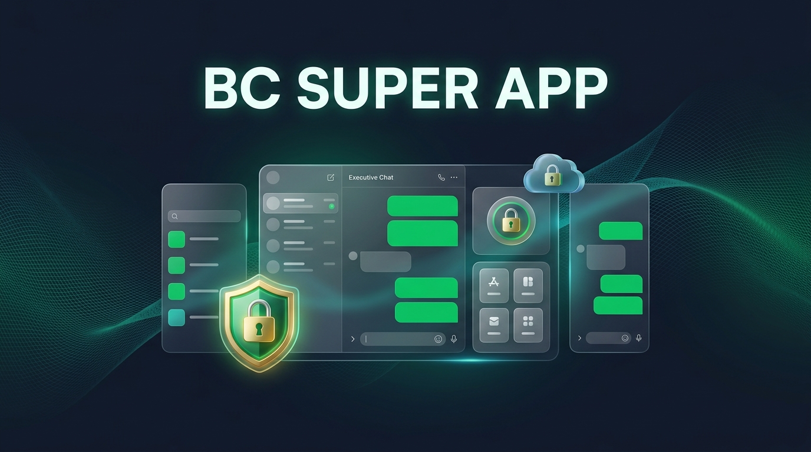
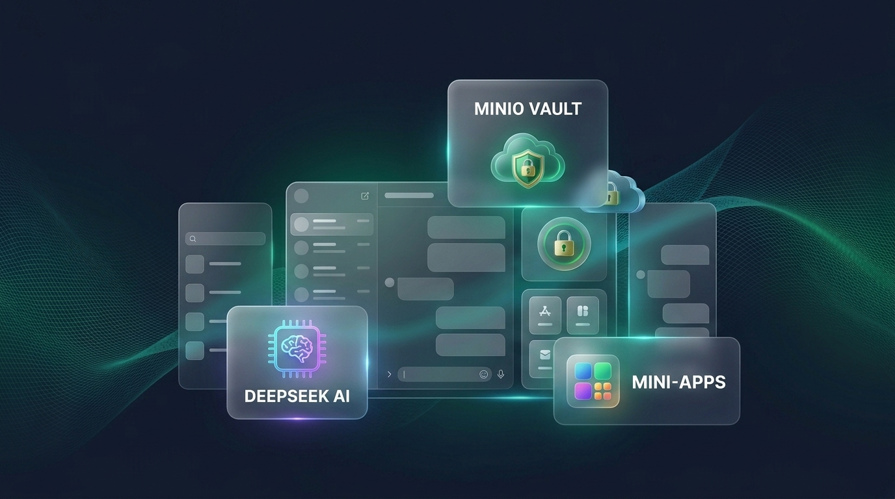

# BC Super App — Enterprise LINE-Style Chat, DeepSeek AI Brain & Mini-App Ecosystem



## Objective
ระบบ **Enterprise Super App** ครบวงจรที่ผสานประสบการณ์แชทแบบ **LINE** ที่คนไทยคุ้นเคยเข้ากับระบบความปลอดภัยระดับองค์กร, สมองกลผู้ช่วยอัจฉริยะ **DeepSeek AI** ประจำทุกคนและทุกกลุ่ม, คลังเก็บไฟล์ถาวรบน **MinIO** ที่ไม่มีวันหมดอายุ, และระบบบริการเสริม **Mini-App (WebView + JS Bridge)** ที่เพิ่มหรือแก้ไขฟีเจอร์จากหลังบ้านได้ทันทีโดยไม่ต้องอัปเดตแอป

รองรับการทำงานแบบ Cross-Platform โค้ดชุดเดียวครบทั้ง **5 แพลตฟอร์ม**: **Android, iOS, macOS, Windows, และ Web-based**

---

## ภาพรวมสถาปัตยกรรมและระบบหลัก (Visual Showcase)



---

## จุดเด่นที่ออกแบบมาเพื่อองค์กร & แก้ Pain Point ผู้ใช้โซเชียล
1. **ส่งผิดลบได้ทันที 100% (Instant Recall & MinIO File Purge)**:
   - ผู้ส่งหรือผู้ดูแลระบบสามารถกด **"ยกเลิกข้อความ & ลบไฟล์"** หรือ **"ลบไร้ร่องรอย (Hard Recall)"** ได้ตลอดเวลาโดยไม่จำกัดเวลา 24 ชั่วโมง
   - ระบบลบข้อความออกจากหน้าจอของทุกคนแบบ Real-time ผ่าน WebSocket **พร้อมสั่งทำลายไฟล์/รูปภาพนั้นออกจาก MinIO Bucket (`bcapp-storage`) และฐานข้อมูล MongoDB ทันที**
2. **เน้นความลับสูงสุดระดับองค์กร (Confidential Mode & Security Watermark)**:
   - โหมดส่งข้อความและเอกสารความลับ (`🔒 ลับเฉพาะองค์กร`) ซ่อนเนื้อหาไว้จนกว่าผู้รับจะแตะเปิดอ่าน พร้อมตั้งรหัส PIN และเวลาทำลายตัวเองอัตโนมัติ (`expire_at`)
   - แสดง **ลายน้ำนิรภัย (Security Watermark)** ชื่อและอีเมลของผู้เปิดดูทับบนห้องแชทเพื่อป้องกันการแคปหน้าจอรั่วไหล
   - ปุ่ม **"ล้างข้อความความลับทั้งหมดในห้องแชท"** สำหรับผู้บริหาร/เจ้าของห้องเมื่อจบภารกิจ
3. **สมองกล DeepSeek AI ประจำทุกคนและทุกกลุ่ม (Enterprise AI Co-Pilot)**:
   - **เรียก `@ai` หรือ `@bc.ai` ในกลุ่มแชท**: วิเคราะห์บริบทการสนทนาในกลุ่มแล้วตอบกลับเข้าห้องแชทให้ทุกคนเห็นพร้อมกันทันที
   - **ปุ่ม `✨ AI สรุปแชท & แกะงาน`**: สรุปบทสนทนายาวๆ เป็นประเด็นสำคัญ (Executive Summary), รายการงานที่ต้องทำต่อ (Action Items), และข้อตกลง (Decisions) พร้อมบันทึกเข้า BC Keep ในคลิกเดียว
   - **ปุ่ม `🪄 AI เกลาคำพูด / แนะนำคำตอบ`**: ปรับข้อความให้สุภาพเป็นทางการระดับองค์กร แปลภาษา หรือแนะนำคำตอบอัตโนมัติ
4. **รูปภาพและไฟล์เอกสารไม่หมดอายุ (Permanent MinIO Vault)**:
   - เก็บไฟล์ถาวรใน MinIO พร้อมแท็บ **"คลังรูปภาพ / ไฟล์เอกสาร / ลิงก์"** ประจำห้องแชท เปิดดูย้อนหลังได้ตลอดชีพ
5. **แยกโฟลเดอร์แชทเรื่องงาน & ส่วนตัว + ซิงค์ข้ามเครื่อง 100% ด้วย Gmail**:
   - แยกหมวดแชท (`ทั้งหมด`, `ส่วนตัว`, `เรื่องงาน`, `กลุ่ม`, `ปักหมุด`, `ยังไม่อ่าน`) ปักหมุดประกาศบนหัวห้องแชท (Pin Banner) และสมุดบันทึก **BC Keep**
6. **สถาปัตยกรรม Rust Backend ความเร็วสูง (High-Performance Architecture)**:
   - สร้าง **MongoDB Compound Indexes** อัตโนมัติสำหรับทุก Collection
   - ใช้ **Batch Query (`$in`)** ป้องกันปัญหา N+1 Query 100% ในการดึงห้องแชทและข้อมูลสมาชิก

---

## Workflow


---

## Config
คัดลอกไฟล์ `.env.example` ไปเป็น `.env` ที่โฟลเดอร์ราก (`.env` ถูกเพิกเฉยใน `.gitignore` เพื่อป้องกันข้อมูลความลับรั่วไหล):
- `PORT=8095` — พอร์ตของ Rust Backend API และ WebSocket
- `MONGODB_URI=mongodb://127.0.0.1:27029` — URI เชื่อมต่อฐานข้อมูล MongoDB
- `MONGODB_DB=bcapp` — ชื่อฐานข้อมูลใน MongoDB
- `MINIO_ENDPOINT=http://127.0.0.1:9120` — Endpoint ของ MinIO S3 API
- `MINIO_ACCESS_KEY` / `MINIO_SECRET_KEY` — ข้อมูลยืนยันตัวตนของ MinIO
- `MINIO_BUCKET=bcapp-storage` — ชื่อ Bucket สำหรับเก็บรูปภาพและเอกสาร
- `JWT_SECRET` — คีย์ลับสำหรับเข้ารหัส JWT
- `GOOGLE_CLIENT_ID` — Google OAuth2 Client ID สำหรับระบบเข้าสู่ระบบด้วย Gmail
- `DEEPSEEK_API_KEY` — API Key ของสมองกล DeepSeek (เก็บเฉพาะใน `.env` หรือตั้งค่าผ่านหน้า Admin Backoffice แบบเข้ารหัส/ซ่อนรหัส `sk-****`)
- `DEEPSEEK_MODEL=deepseek-chat` — รุ่นโมเดล (`deepseek-chat` หรือ `deepseek-reasoner`)

---

## Dependency
- **Docker & Docker Compose**: สำหรับรัน `bcapp-mongodb` (MongoDB 7.0) และ `bcapp-minio` (MinIO)
- **Rust**: `1.95+` (`axum`, `tokio`, `mongodb`, `reqwest`, `jsonwebtoken`, `hmac`, `sha2`)
- **Flutter**: `3.41+` / Dart `3.11+` (รองรับ `android`, `ios`, `macos`, `windows`, `web`)
- **Node.js**: `20+` สำหรับรันชุดทดสอบอัตโนมัติ `e2e_test.mjs`

---

## Usage Example
```powershell
# 1. สตาร์ท MongoDB และ MinIO ด้วย Docker Compose
cd d:\bcapp
Copy-Item .env.example .env
docker compose up -d

# 2. รัน Rust Backend (พอร์ต 8095)
cd d:\bcapp\backend
cargo run

# 3. รัน Flutter Frontend (เลือกแพลตฟอร์ม Web / Windows / Android / iOS / macOS)
cd d:\bcapp\frontend
flutter run -d chrome --web-port 3095
# หรือรันบน Windows Desktop:
# flutter run -d windows

# 4. รันการทดสอบอัตโนมัติครบวงจร (Integration Test + E2E 12 ขั้นตอน)
cd d:\bcapp\backend
cargo test
cd d:\bcapp
node e2e_test.mjs
```

---

## Limitation
- การล็อกอินด้วย Google Sign-In บนโดเมน Production ต้องผูก `GOOGLE_CLIENT_ID` ที่ตั้งค่า Authorized Origins ใน Google Cloud Console ให้ตรงกับโดเมนจริง
- การคอมไพล์แอปสำหรับ `iOS` และ `macOS` ต้องรันคำสั่ง `flutter build ios` / `flutter build macos` บนเครื่องระบบปฏิบัติการ macOS ที่มี Xcode ติดตั้งอยู่
