# BC Super App — Enterprise Chat, DeepSeek AI Brain & Mini-App Ecosystem


## Objective
ระบบ **Enterprise Super App** ครบวงจรที่ผสานประสบการณ์แชทใช้งานง่ายแบบที่คนไทยคุ้นเคยเข้ากับระบบความปลอดภัยระดับองค์กร, สมองกลผู้ช่วยอัจฉริยะ **DeepSeek AI** ประจำทุกคนและทุกกลุ่ม, คลังเก็บไฟล์ถาวรบน **MinIO** ที่ไม่มีวันหมดอายุ, และระบบบริการเสริม **Mini-App (WebView + JS Bridge)** ที่เพิ่มหรือแก้ไขฟีเจอร์จากหลังบ้านได้ทันทีโดยไม่ต้องอัปเดตแอป

รองรับการทำงานแบบ Cross-Platform โค้ดชุดเดียวครบทั้ง **5 แพลตฟอร์ม**: **Android, iOS, macOS, Windows, และ Web-based**

---

## ภาพหน้าจอมือถือจริง (Mobile Application Screenshots — Android & iOS)

| 1. เข้าสู่ระบบด้วย Gmail (Mobile) | 2. รายการแชท & โฟลเดอร์งาน (Mobile) | 3. ห้องแชท + รับงาน + AI (Mobile) |
| :---: | :---: | :---: |
| 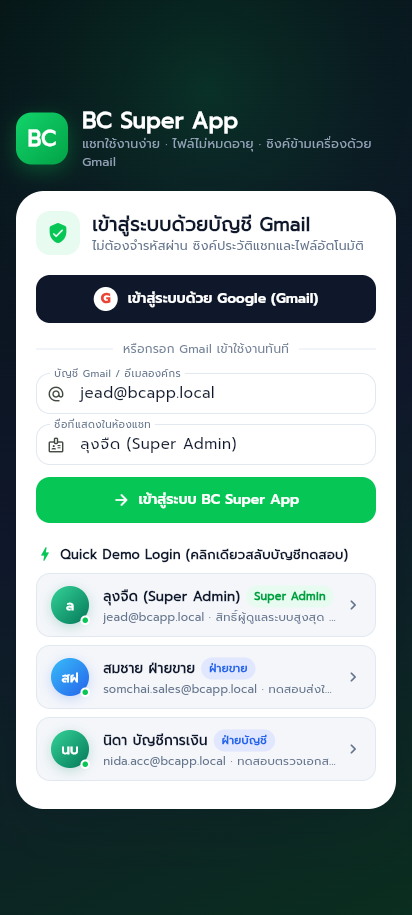 | 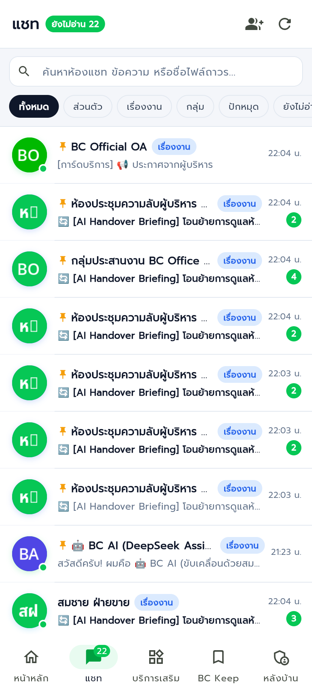 | 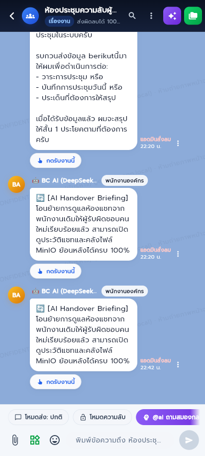 |

| 4. หน้าหลัก โปรไฟล์ & QR Code (Mobile) | 5. ศูนย์บริการเสริม Mini-Apps (Mobile) | 6. หลังบ้าน Admin & โอนงาน AI (Mobile) |
| :---: | :---: | :---: |
| 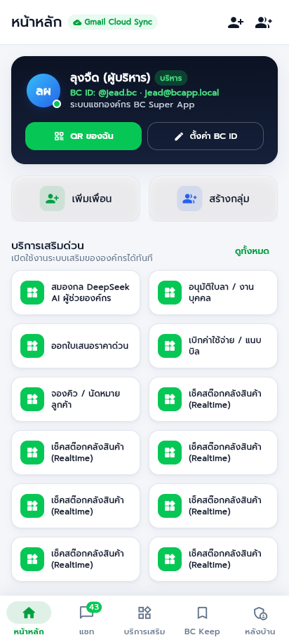 | 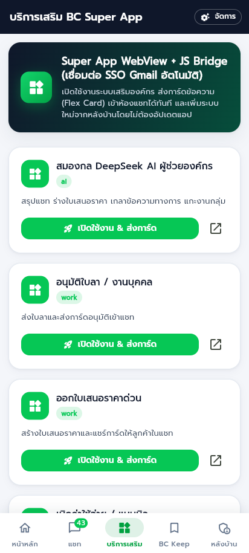 | 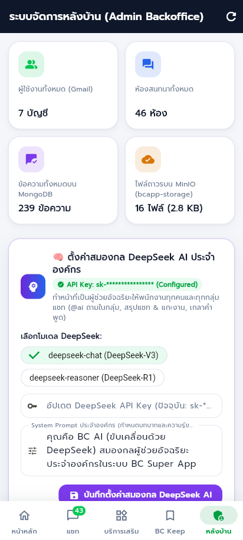 |

---

## ภาพหน้าจอคอมพิวเตอร์และเว็บจริง (Desktop & Web Split-View Screenshots)

### 1. หน้าเข้าสู่ระบบด้วยบัญชี Gmail & สลับบัญชีองค์กรด่วน
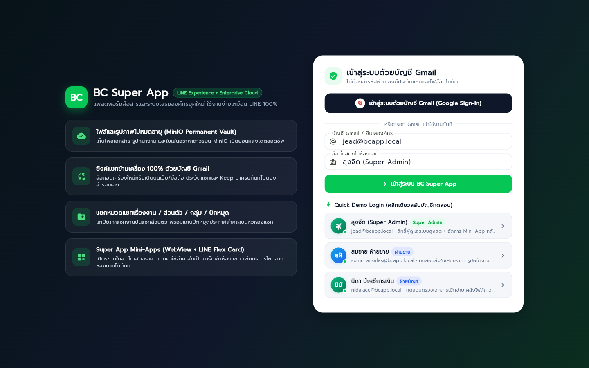

### 2. ห้องแชทแบบ Split-View + ปุ่มกดรับงาน + อนุมัติการ์ดในแชท + สมองกล DeepSeek AI
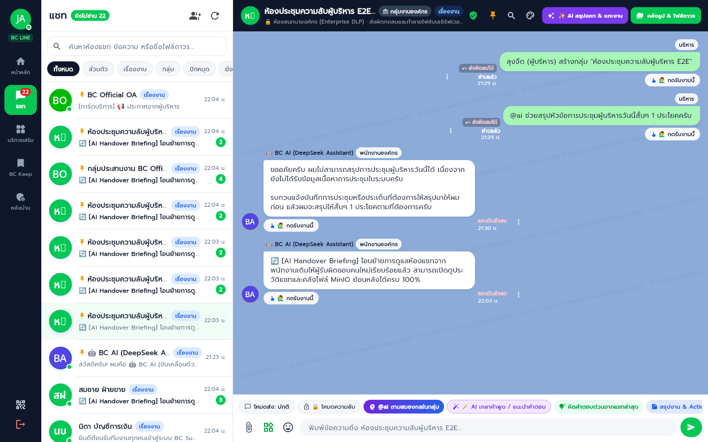

### 3. หน้าหลัก (โปรไฟล์องค์กร, ตั้งค่า BC ID, QR Code, รายชื่อเพื่อน & กลุ่ม)
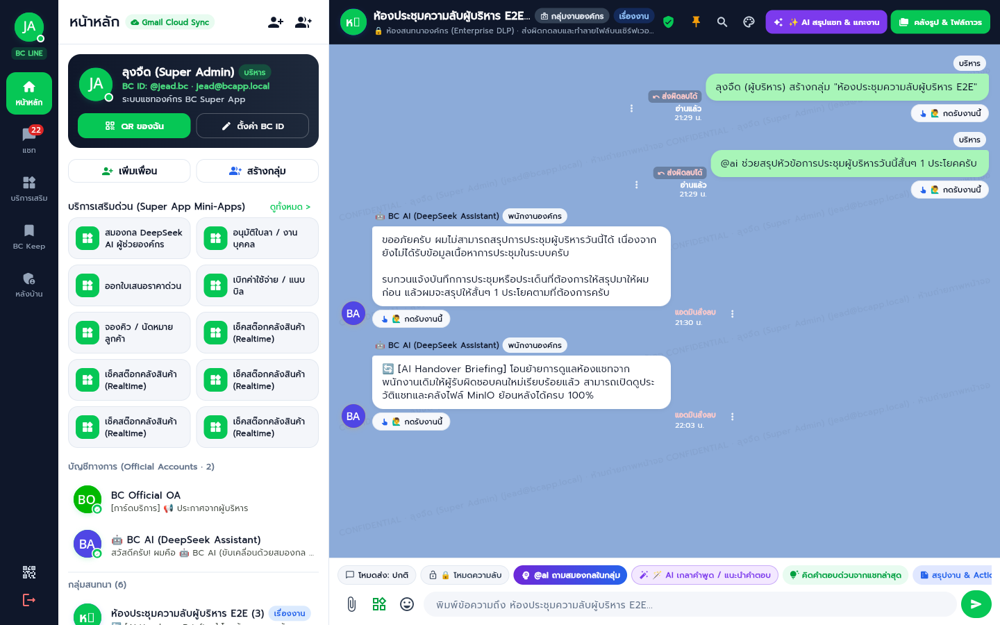

### 4. ศูนย์รวมบริการเสริม Super App (Mini-Apps Center — แก้ไขได้โดยไม่ต้องอัปเดตแอป)
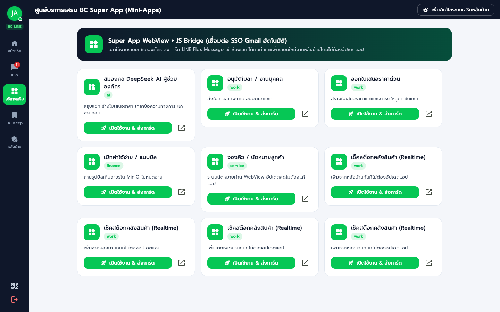

### 5. ระบบหลังบ้าน (Admin Backoffice, ตั้งค่า DeepSeek AI, และโอนย้ายงานเมื่อพนักงานลาออก)
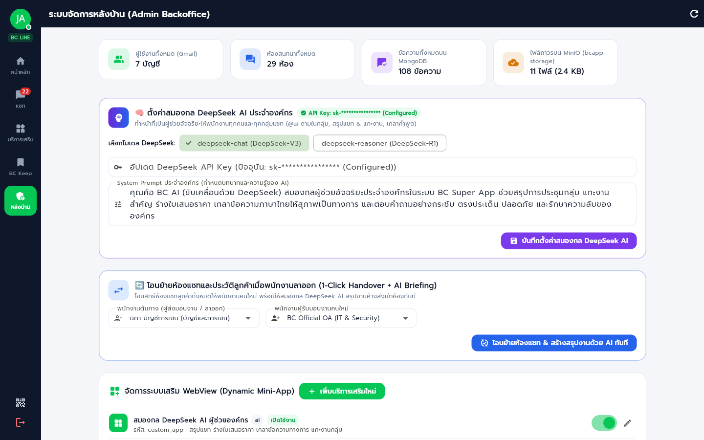

### 6. หน้าจอระบบเสริม WebView จริงพร้อม SSO Token & ส่งการ์ดเข้าห้องแชท
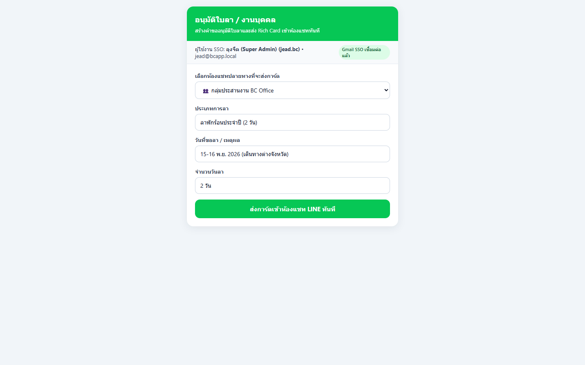

---

## จุดเด่นที่ออกแบบมาเพื่อองค์กร & แก้ Pain Point ผู้ใช้โซเชียล
1. **ส่งผิดลบได้ทันที 100% (Instant Recall & MinIO File Purge)**:
   - ผู้ส่งหรือผู้ดูแลระบบสามารถกด **"ยกเลิกข้อความ & ลบไฟล์"** หรือ **"ลบไร้ร่องรอย (Hard Recall)"** ได้ตลอดเวลาโดยไม่จำกัดเวลา 24 ชั่วโมง
   - ระบบลบข้อความออกจากหน้าจอของทุกคนแบบ Real-time ผ่าน WebSocket **พร้อมสั่งทำลายไฟล์/รูปภาพนั้นออกจาก MinIO Bucket (`bcapp-storage`) และฐานข้อมูล MongoDB ทันที**
2. **เน้นความลับสูงสุดระดับองค์กร (Confidential Mode & Security Watermark)**:
   - โหมดส่งข้อความและเอกสารความลับ (`🔒 ลับเฉพาะองค์กร`) ซ่อนเนื้อหาไว้จนกว่าผู้รับจะแตะเปิดอ่าน พร้อมตั้งรหัส PIN และเวลาทำลายตัวเองอัตโนมัติ (`expire_at`)
   - แสดง **ลายน้ำนิรภัย (Security Watermark)** ชื่อและอีเมลของผู้เปิดดูทับบนห้องแชทเพื่อป้องกันการแคปหน้าจอรั่วไหล
   - ปุ่ม **"ล้างข้อความความลับทั้งหมดในห้องแชท"** สำหรับผู้บริหาร/เจ้าของห้องเมื่อจบภารกิจ
3. **สมองกล DeepSeek AI ประจำทุกคนและทุกกลุ่ม (Enterprise AI Co-Pilot)**:
   - **เรียก `@ai` หรือ `@bc.ai` ในกลุ่มแชท**: วิเคราะห์บริบทการสนทนาในกลุ่มแล้วตอบกลับเข้าห้องแชทให้ทุกคนเห็นพร้อมกันทันที — AI เห็นสถานะงานใต้ข้อความด้วย (ใครกดรับ / ใครทำเสร็จแล้ว) จึงไม่ทวงงานที่ปิดไปแล้ว
   - **ปุ่ม `✨ AI สรุปแชท & แกะงาน`**: สรุปบทสนทนายาวๆ เป็น 3 ส่วน ประเด็นสำคัญ / สิ่งที่ต้องทำต่อ (พร้อมชื่อคนรับผิดชอบ) / ข้อตกลงของทีม แสดงเป็นข้อความอ่านง่ายไม่มีเครื่องหมาย Markdown; ปุ่ม **"บันทึกเข้า BC Keep"** เก็บทั้งเป็นโน้ตของห้องและโน้ตส่วนตัวในเมนู BC Keep (เปิดแท็บ BC Keep แล้วโหลดใหม่ทุกครั้ง)
   - **ปุ่มผู้ช่วยในช่องพิมพ์ (`assist_message_handler`)** 4 โหมด: `polish` เกลาคำพูดให้สุภาพเป็นทางการ, `suggest_reply` คิดคำตอบ 3 แบบในมุมของเราจากแชทล่าสุด, `action_plan` แตกเป้าหมายเป็นแผนงานทีละขั้น, `translate_en` แปลเป็นภาษาอังกฤษธุรกิจ — ผลลัพธ์กดนำไปใส่ช่องพิมพ์หรือส่งเข้าห้องได้ทันที (คำตอบเก่าที่มาช้าไม่ทับคำขอล่าสุด)
   - **ห้องส่วนตัว "BC AI ผู้ช่วยอัจฉริยะ"**: คุยกับ AI ได้ทุกเวลา เช่น ร่างข้อความทวงเงิน ร่างประกาศ (ควรตรวจรายละเอียดก่อนส่งต่อ)
   - **โอนงานเมื่อพนักงานลาออก (หลังบ้าน)**: ย้ายห้องแชททั้งหมดจากพนักงานต้นทางให้ผู้รับงานคนใหม่ แล้ว AI สรุปงานค้างของคนเดิมส่งเข้าแต่ละห้อง (ถ้า AI ไม่ตอบ จะส่งเฉพาะข้อความแจ้งโอนย้าย ไม่อ้างว่า AI สรุปแล้ว)
4. **รูปภาพและไฟล์เอกสารไม่หมดอายุ (Permanent MinIO Vault)**:
   - เก็บไฟล์ถาวรใน MinIO พร้อมแท็บ **"คลังรูปภาพ / ไฟล์เอกสาร / ลิงก์"** ประจำห้องแชท เปิดดูย้อนหลังได้ตลอดชีพ
5. **แยกโฟลเดอร์แชทเรื่องงาน & ส่วนตัว + ซิงค์ข้ามเครื่อง 100% ด้วย Gmail**:
   - แยกหมวดแชท (`ทั้งหมด`, `ส่วนตัว`, `เรื่องงาน`, `กลุ่ม`, `ปักหมุด`, `ยังไม่อ่าน`) ปักหมุดประกาศบนหัวห้องแชท (Pin Banner) และสมุดบันทึก **BC Keep**
6. **สถาปัตยกรรม Rust Backend ความเร็วสูง (High-Performance Architecture)**:
   - สร้าง **MongoDB Compound Indexes** อัตโนมัติสำหรับทุก Collection
   - ใช้ **Batch Query (`$in`)** ป้องกันปัญหา N+1 Query 100% ในการดึงห้องแชทและข้อมูลสมาชิก
7. **หน้าจอพรีเมียมระบบเดียวทั้งแอป (Global Design System — `frontend/lib/theme/app_theme.dart`)**:
   - รวมสี, มุมโค้ง (`radiusSm/Md/Lg/Xl`), เงาซ้อนสองชั้น (`shadowSm/Md/Lg`), Gradient และจังหวะแอนิเมชัน (`motionFast/Med`) ไว้ที่เดียว ทุกหน้าจอเรียกใช้ค่าเดียวกัน
   - แผงกระจกฝ้า `GlassPanel` (ช่องพิมพ์ข้อความ, แบนเนอร์ปักหมุด), แอนิเมชันจางเลื่อนตอนสลับแท็บและเปิดห้องแชท, ข้อความใหม่ค่อยๆ ปรากฏ
   - ฟอนต์ Prompt ตั้งระยะบรรทัดเผื่อสระ-วรรณยุกต์ไทยไม่ชนกัน, อวาตาร์ตัวย่อชื่อไทยวาดในแอปเอง (ข้ามสระนำ/วรรณยุกต์)
   - Baseline-First: ไอคอน ตัวหนังสือ Badge ในแถวเดียวกันอยู่กึ่งกลางระนาบเดียวกัน, ข้อความยาวตัดด้วย `…` ไม่เกิด RenderFlex overflow ทั้งมือถือ 412x915 และเดสก์ท็อป 1440x900
   - มือถือ: แถบเมนูล่าง, หัวห้องแชทย่อปุ่มเป็นไอคอน + เมนู ⋮, การ์ดเต็มความกว้าง; เดสก์ท็อป: แถบเมนูข้างไล่สีกรมท่า + Split-View รายการแชท/ห้องแชท
8. **การแจ้งเตือนข้อความใหม่ + เสียงเตือนเลือกได้ (`frontend/lib/services/notification_service.dart`)**:
   - ป๊อปอัปของระบบปฏิบัติการ (Windows Toast, Android, เว็บ, iOS/macOS): กลุ่มแสดงชื่อห้อง + "ชื่อคนส่ง: ข้อความ", แชทเดี่ยวแสดงชื่อคนส่ง; รูป/ไฟล์/สติกเกอร์/การ์ดแสดงเป็นคำอธิบาย, ข้อความลับซ่อนเนื้อหา, ข้อความด่วนขึ้น "⚡ ด่วน:"; **แตะป๊อปอัปเปิดห้องนั้นทันที**
   - ไม่เตือนข้อความของตัวเอง และไม่เตือนห้องที่เปิดดูอยู่ขณะแอปอยู่หน้าจอ; ตัวเลขยังไม่อ่านแสดงที่แท็บ "แชท" และรายการห้อง
   - ปุ่มกระดิ่งที่หัวแท็บแชท → **"เสียงและการแจ้งเตือน"**: เปิด/ปิดป๊อปอัป, เปิด/ปิดเสียง, เลือกเสียงแยกตาม *ข้อความทั่วไป / ข้อความด่วน ⚡ / BC AI ตอบกลับ* จาก 8 เสียง (ติ๊ง, ป๊อป, กริ๊งสองจังหวะ, มาริมบา, ระฆังใส, นุ่มนวล, ด่วนมาก, หุ่นยนต์ AI) หรือไม่มีเสียง แตะแล้วได้ยินตัวอย่าง + ปุ่ม "ลองแจ้งเตือน"; ตั้งค่าเก็บแยกต่อเครื่อง; ผู้ส่งเลือกส่งแบบเงียบได้ (ไม่มีเสียงที่ผู้รับ)
   - เสียงทุกไฟล์ (`frontend/assets/sounds/*.wav`) สังเคราะห์เองด้วย `frontend/tool/make_alert_sounds.mjs` ไม่ใช้เสียงของบุคคลอื่น
9. **ธีมสีตามประเภทกิจการ (Admin)**: ผู้ดูแลเลือกธีม 7 แบบ (ภาษาไทย) ในหลังบ้าน ทุกเครื่องในองค์กรเปลี่ยนสีทันทีผ่าน WebSocket `theme_changed`
10. **บัญชีทดสอบแชท 5 คน**: `tester1-5@bcapp.local` อยู่ใน "ห้องทดสอบแชท 5 คน" พร้อม BC AI; บน Windows กดปุ่ม **"เปิด 5 หน้าต่าง คุยกันได้ทันที"** ที่หน้าเข้าสู่ระบบ (แต่ละหน้าต่าง login อัตโนมัติและเรียงกันบนจอ)
11. **สิทธิ์การเข้าถึง**: อ่าน/ส่ง/รับ WebSocket ของห้องได้เฉพาะสมาชิกห้อง; `/api/admin/*` และตั้งค่า AI ใช้ได้เฉพาะ role `admin`; ยกเลิกข้อความ / ลบไฟล์ถาวรได้เฉพาะผู้ส่งข้อความนั้นหรือ `admin`; ผู้สมัครใหม่เป็น role `user` (ผู้ดูแลเลื่อนสิทธิ์ในหลังบ้าน)
12. **แจ้งเตือนตอนปิดแอป (Push ผ่าน Firebase Cloud Messaging — Android & เว็บ)**: backend ส่ง push เฉพาะเครื่องที่ไม่ได้ต่อ WebSocket อยู่ (ไม่เด้งซ้ำกับป๊อปอัปในแอป) ใช้เสียงที่เลือกไว้ต่อเครื่อง แตะแล้วเปิดห้องนั้น; แอปต่อ WebSocket ใหม่เองเมื่อเน็ตหลุด/เซิร์ฟเวอร์รีสตาร์ท และ backend ping ทุก 20 วินาทีเพื่อจับเครื่องที่หลุดเงียบ — วิธีสร้าง Firebase และรายละเอียด: [docs/push-fcm.md](docs/push-fcm.md)

---

## วิดีโอสาธิตสำหรับ YouTube (`video-demo/`)
**Objective**: สร้างคลิปสาธิตภาษาไทย 1080p (~9 นาที) เน้น "AI ช่วยอะไรบ้าง" จากหน้าจอแอปจริง + เสียงพากย์ ElevenLabs + motion graphics (กล่องชี้, แผนภาพ AI 8 เรื่อง, ประโยชน์ที่ธุรกิจได้รับ) — ข้อมูลในคลิปเป็นร้านตัวอย่าง "สมใจค้าส่ง" ทั้งหมด

**Workflow**: `script.json` (บทพากย์ทีละฉาก) → `tts.mjs` (เสียง + เวลาทุกคำ → `narration.wav`, `timeline.json`) → `seed.mjs` (สร้างข้อมูลเดโมผ่าน API) → `capture.mjs` (Playwright คลิก/พิมพ์ตรงจังหวะคำพากย์ บันทึกเฟรมหน้าจอ + ตำแหน่งกล่องชี้) → `build.mjs` (`data.js`) → `video.html` (ประกอบภาพ + กราฟิก) → `render.mjs` (Chrome → ffmpeg → `bcsuperapp-demo.mp4`, −14 LUFS) → `thumb.mjs` (หน้าปก 1280x720)

**Config**: backend ต้องรันด้วย `MONGODB_DB=bcapp_demo` (`seed.mjs` ปฏิเสธฐานอื่น) ที่ `:8095` และเว็บ `flutter build web --release` เสิร์ฟที่ `:3095`; คีย์ ElevenLabs อ่านจากไฟล์ `%LOCALAPPDATA%\BotPress\elevenlabs.key` ตอนรันเท่านั้น (ไม่อยู่ใน repo); เสียง Kanya ภาษาไทย

**Dependency**: Node.js 20+, `playwright` (ใช้ Google Chrome ที่ติดตั้งในเครื่อง), ffmpeg/ffprobe, บัญชี ElevenLabs, DeepSeek API key ใน backend (ฉาก AI ตอบจริง)

**Usage example**:
```powershell
cd d:\bcapp\video-demo
npm i --no-save playwright
node tts.mjs                              # เสียงพากย์ (แคชตามข้อความ แก้บทแล้วรันใหม่เฉพาะฉากที่เปลี่ยน)
node seed.mjs; node capture.mjs           # ถ่ายทุกฉากต่อเนื่อง ~9.5 นาที
# $env:ONLY="summary,vault"; node capture.mjs   # ถ่ายซ้ำบางฉาก (seed ใหม่ก่อนเสมอ)
node build.mjs
node render.mjs 133 403                   # ตรวจภาพนิ่งวินาทีที่ 133, 403 -> check\t*.jpg
node render.mjs                           # วิดีโอเต็ม -> bcsuperapp-demo.mp4
node thumb.mjs check/t133.jpg             # หน้าปก -> thumbnail.jpg
```
ชื่อคลิป คำอธิบาย ช่วงเวลา (chapters) และแท็กสำหรับ YouTube อยู่ใน [video-demo/youtube.txt](video-demo/youtube.txt)

**Limitation**: `capture.mjs` เดินตามเวลาจริงของเสียงพากย์ ถ้าเครื่องช้าหรือ AI ตอบช้ากว่าบท ภาพจะไม่ตรงคำพูด (ดูบรรทัด `nobox`/`slowgrab` ใน log แล้วถ่ายซ้ำฉากนั้น); ไฟล์เสียง/เฟรม/วิดีโอ/รูปไม่เก็บใน git ต้องสร้างใหม่ทุกเครื่อง

---

## Workflow
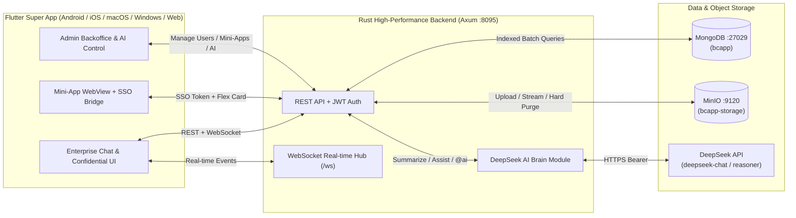

---

## Config
คัดลอกไฟล์ `.env.example` ไปเป็น `.env` ที่โฟลเดอร์ราก (`.env` ถูกเพิกเฉยใน `.gitignore` เพื่อป้องกันข้อมูลความลับรั่วไหล):
- `PORT=8095` — พอร์ตของ Rust Backend API และ WebSocket
- `MONGODB_URI=mongodb://127.0.0.1:27029` — URI เชื่อมต่อฐานข้อมูล MongoDB
- `MONGODB_DB=bcapp` — ชื่อฐานข้อมูลใน MongoDB
- `MINIO_ENDPOINT=http://127.0.0.1:9120` — Endpoint ของ MinIO S3 API
- `MINIO_ACCESS_KEY` / `MINIO_SECRET_KEY` — ข้อมูลยืนยันตัวตนของ MinIO
- `MINIO_BUCKET=bcapp-storage` — ชื่อ Bucket สำหรับเก็บรูปภาพและเอกสาร
- `JWT_SECRET` — คีย์ลับสำหรับเข้ารหัส JWT
- `GOOGLE_CLIENT_ID` — Google OAuth2 Client ID สำหรับระบบเข้าสู่ระบบด้วย Gmail
- `DEEPSEEK_API_KEY` — API Key ของสมองกล DeepSeek (เก็บเฉพาะใน `.env` หรือตั้งค่าผ่านหน้า Admin Backoffice แบบเข้ารหัส/ซ่อนรหัส `sk-****`)
- `DEEPSEEK_MODEL=deepseek-chat` — รุ่นโมเดล (`deepseek-chat` หรือ `deepseek-reasoner`)
- `FCM_SERVICE_ACCOUNT_FILE` — path ไฟล์ service account ของ Firebase (เช่น `secrets/fcm-service-account.json` นับจาก `backend/`); ว่าง = ปิด push
- `FCM_WEB_API_KEY` / `FCM_WEB_APP_ID` / `FCM_WEB_SENDER_ID` / `FCM_WEB_VAPID_KEY` — ค่าแอปเว็บใน Firebase สำหรับ push บนเบราว์เซอร์ (ดู [docs/push-fcm.md](docs/push-fcm.md))

---

## Dependency
- **Docker & Docker Compose**: สำหรับรัน `bcapp-mongodb` (MongoDB 7.0) และ `bcapp-minio` (MinIO)
- **Rust**: `1.95+` (`axum`, `tokio`, `mongodb`, `reqwest`, `jsonwebtoken`, `hmac`, `sha2`)
- **Flutter**: `3.41+` / Dart `3.11+` (รองรับ `android`, `ios`, `macos`, `windows`, `web`)
- **Node.js**: `20+` สำหรับรันชุดทดสอบอัตโนมัติ `e2e_test.mjs` / `e2e_chat5.mjs` และสร้างไฟล์เสียงเตือน
- **Visual Studio Build Tools 2022** (build Windows): workload "Desktop development with C++" + ส่วนเสริม **"C++ ATL for latest v143 build tools"** (แพ็กเกจแจ้งเตือนบน Windows ต้องใช้)
- **แพ็กเกจ Flutter สำหรับแจ้งเตือน**: `flutter_local_notifications` (ป๊อปอัป), `audioplayers` (เล่นเสียงที่เลือก); Android เปิด core library desugaring ใน `android/app/build.gradle.kts`
- **Push**: Android `firebase-messaging` (Firebase BoM 35.1.0) + Gradle plugin `com.google.gms.google-services` 4.5.0 (ใช้เมื่อมี `frontend/android/app/google-services.json`), เว็บใช้ Firebase JS SDK 13.2.0 จาก gstatic; **openssl** สำหรับ `cargo test --test push_integration`

---

## Usage Example
```powershell
# 1. สตาร์ท MongoDB และ MinIO ด้วย Docker Compose
cd d:\bcapp
Copy-Item .env.example .env
docker compose up -d

# 2. รัน Rust Backend (พอร์ต 8095)
cd d:\bcapp\backend
cargo run

# 3. รัน Flutter Frontend (เลือกแพลตฟอร์ม Web / Windows / Android / iOS / macOS)
cd d:\bcapp\frontend
flutter run -d chrome --web-port 3095
# หรือรันบน Windows Desktop:
# flutter run -d windows

# 4. รันการทดสอบอัตโนมัติครบวงจร (Integration Test + E2E 15 ขั้นตอน + แชท 5 คน 12 ขั้นตอน)
cd d:\bcapp\backend
cargo test
cd d:\bcapp
node e2e_test.mjs
node e2e_chat5.mjs   # แชท 5 คน realtime, กลุ่ม + AI เลขา, รูป/PDF, ตรวจ MongoDB + MinIO, คนนอกห้องถูกปฏิเสธ

# 5. Build release แต่ละแพลตฟอร์ม
cd d:\bcapp\frontend
flutter analyze; flutter test
node tool/make_alert_sounds.mjs   # สร้างไฟล์เสียงเตือนใหม่ (เมื่อแก้เสียง)
flutter build web --release       # -> build\web
flutter build windows --release   # -> build\windows\x64\runner\Release\frontend.exe
flutter build apk --release       # -> build\app\outputs\flutter-apk\app-release.apk
# iOS / macOS ต้อง build บนเครื่อง macOS ที่มี Xcode:
# flutter build ios --release ; flutter build macos --release
```

---

## Limitation
- การล็อกอินด้วย Google Sign-In บนโดเมน Production ต้องผูก `GOOGLE_CLIENT_ID` ที่ตั้งค่า Authorized Origins ใน Google Cloud Console ให้ตรงกับโดเมนจริง
- การคอมไพล์แอปสำหรับ `iOS` และ `macOS` ต้องรันคำสั่ง `flutter build ios` / `flutter build macos` บนเครื่องระบบปฏิบัติการ macOS ที่มี Xcode ติดตั้งอยู่
- แจ้งเตือนตอนปิดแอปสนิทใช้ได้บน Android และเว็บ หลังสร้างโปรเจกต์ Firebase และใส่คีย์ตาม [docs/push-fcm.md](docs/push-fcm.md); Windows เตือนได้เฉพาะตอนแอปเปิดอยู่ (FCM ไม่รองรับ Windows), iOS/macOS ต้องใช้ APNs + บัญชี Apple Developer (ยังไม่ทำ)
- เว็บ: เบราว์เซอร์ต้องอนุญาตการแจ้งเตือน (บางเบราว์เซอร์ เช่น Firefox ถามได้เฉพาะเมื่อผู้ใช้กดเอง) และเล่นเสียงได้หลังผู้ใช้แตะหน้าเว็บแล้วอย่างน้อยครั้งหนึ่ง
